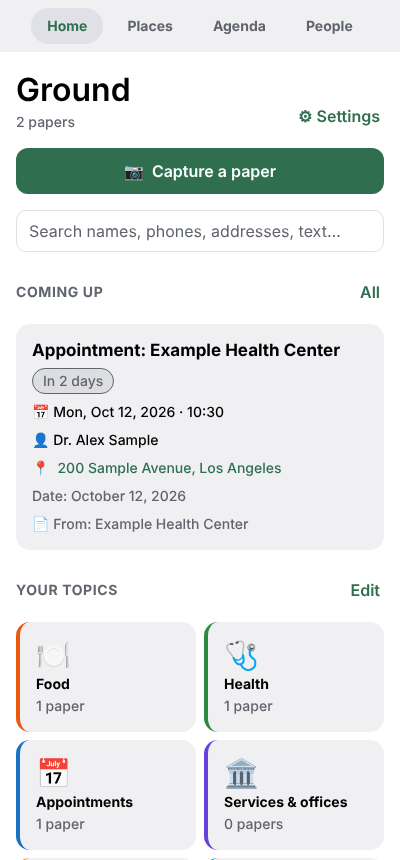
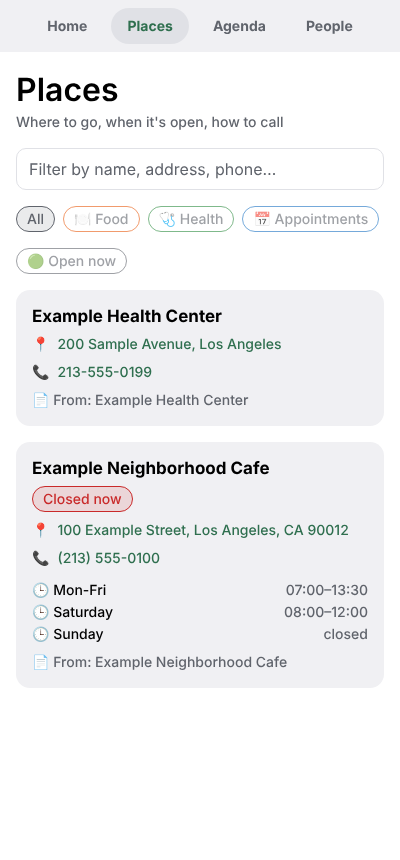
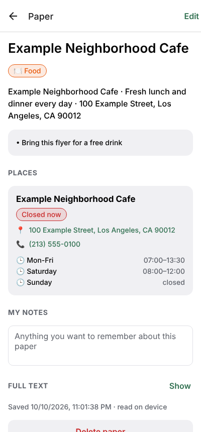
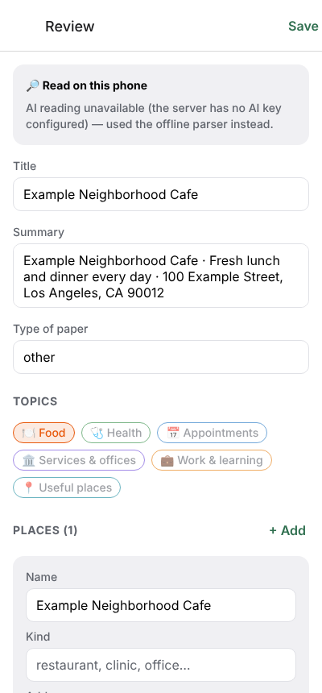

# Ground

Ground turns paper documents (flyers, schedules, letters, appointment reminders, brochures, business cards) into a personal guide you can search.

Take a photo of a paper. Ground reads it and pulls out:

- **Places**: name, kind, address, phone, email, website, **opening hours** (with an "open now" badge)
- **People**: doctors, case workers, contacts, with their role, organization and phone
- **Appointments**: what, date, time, where, with whom
- **Good to know**: what to bring, eligibility, costs
- The **full text**, so everything is searchable

Each paper is filed under your **topics** (Food, Health, Appointments, Services & offices, Work & learning, Useful places, or your own). You always review and correct what was read before it's saved.

| Home | Places | A paper | Review |
| --- | --- | --- | --- |
|  |  |  |  |

_Screenshots use made-up example data._

## How it's built

An npm-workspaces monorepo, all TypeScript:

```
apps/mobile     Expo (React Native) app: Expo Router, Redux Toolkit + redux-persist
apps/server     Node REST API: Express, SQLite (node:sqlite), Claude for reading photos
packages/core   Shared domain model (zod schemas), default topics, offline parser, search helpers
```

```
 phone camera ──► capture ──► extract ──► review & edit ──► Redux store ──► AsyncStorage
                                │                              │
                                │ server configured?           │ sync (push dirty / pull since cursor)
                                ▼                              ▼
                     POST /api/extract (Claude)        POST /api/sync ──► SQLite
                     else: offline parser (core)
```

### Mobile app (`apps/mobile`)

- **Screens** (`src/app`, Expo Router): Home (search, upcoming appointments, topics, recent papers), Places (filter by topic, "open now"), Agenda (upcoming/past), People, plus Capture, Review, Paper detail/edit, Topic, Topics editor and Settings.
- **State** (`src/store`): Redux Toolkit slices for `documents`, `topics`, `settings` (persisted) and `capture` (the in-progress photo + draft, not persisted). Places, people and appointments are not stored separately: memoized selectors flatten them out of the documents, so a paper is the single source of truth and every item links back to the paper it came from.
- **Works offline.** Without a server, Ground uses the rule-based parser in `packages/core` on text you type or paste. It finds phone numbers, emails, websites, dates (several formats and languages), times, opening hours and street addresses, and assigns topics by keyword. Photos are still attached to the paper.
- **Sync**: every change marks the document "dirty". `syncNow` pushes dirty documents and pending deletes, then pulls everything that changed on the server since its last cursor. It runs after saves and edits, on app start, and when the app comes back to the foreground. Photos stay on the device that took them.

### Server (`apps/server`)

| Method & path | What it does |
| --- | --- |
| `GET /api/health` | `{ ok, ai, authRequired }` |
| `POST /api/extract` | `{ images: [{data, mediaType}], text?, topics, today, locale }` → extracted document |
| `POST /api/sync` | Push changes and pull changes since `sinceSeq` in one round trip |
| `GET/PUT/DELETE /api/documents[/:id]` | Plain CRUD (`GET ?sinceSeq=` for incremental) |
| `GET/PUT/DELETE /api/topics[/:id]` | Same, for topics |

- Storage is SQLite. Each record is stored as JSON, with a server-side sequence number used as the sync cursor (so device clocks don't matter) and tombstones for deletes. Conflicting edits resolve as last-write-wins on `updatedAt`.
- **AI extraction** sends the photos (several pages are allowed) to Claude with a structured-output schema (`ExtractionSchema` in `packages/core`), so the response is always valid, typed JSON. The prompt tells the model to only report what the paper says, to resolve dates against "today", and to use only your topic ids. If the safety classifier declines a request (medical papers can trigger it), server-side fallbacks retry on another model automatically.
- Optional **bearer-token auth** (`GROUND_API_TOKEN`). Set it: these are personal papers.

## Getting started

Requirements: Node 22.13+ (for `node:sqlite`), and the Expo Go app or a development build on your phone.

```bash
npm install

# 1. Server (optional, but needed for AI reading and keeping data across devices)
cp apps/server/.env.example apps/server/.env   # set ANTHROPIC_API_KEY and GROUND_API_TOKEN
npm run server                                 # http://0.0.0.0:4000

# 2. App
npm run mobile                                 # scan the QR code with Expo Go
```

In the app, open **Settings** and enter the server address as your phone sees it (e.g. `http://192.168.1.20:4000`, not `localhost`) and the token. **Save & connect** checks the connection and runs the first sync.

### Deploy on Render (works from a phone)

Render runs the server **and** a web version of the app at one address, so you can use Ground from your phone's browser without a computer or an app store.

1. **Anthropic API key:** sign in at [console.anthropic.com](https://console.anthropic.com), add credits under *Billing* (prepaid), then *API keys → Create key*. Copy it right away, because it's only shown once.
2. **Render:** *New → Blueprint*, connect GitHub, and pick this repository (Render needs access to it if it's private). Render reads `render.yaml`, asks you for `ANTHROPIC_API_KEY` (paste the key), and generates `GROUND_API_TOKEN` for you.
3. When the deploy finishes, open the service URL (`https://ground-xxxx.onrender.com`) on your phone.
4. In Ground, open **Settings**. The server address is already filled in. Paste the `GROUND_API_TOKEN` value from Render's *Environment* tab and tap **Save & connect**.
5. Optional: use your browser's *Add to Home Screen* to get an app icon.

Notes:
- The blueprint uses the paid **Starter** plan with a 1 GB disk, because the free plan erases the SQLite database on every restart.
- In the browser version, photos are read and their details saved, but the photo itself isn't kept (browser storage is too small). The native app keeps photos.
- Set `GROUND_MODEL=claude-sonnet-5-5` in Render to roughly halve the AI cost per paper.

### Checks

```bash
npm test            # core parser, server API, and client sync reducer tests
npm run typecheck
npm run lint -w @ground/mobile
```

## Privacy notes

- Without a server configured, nothing leaves the phone.
- With a server, papers sync to **your** SQLite file. Photos are sent to the server only for AI reading, and the server passes them to the Anthropic API. The server does not store photos.
- The AI step can be turned off in Settings at any time.
- **Export everything (JSON)** in Settings shares all your data.

## Roadmap ideas

- On-device OCR (ML Kit / Apple Vision through a development build), so photos can be read offline
- Downscale and deskew photos before upload, and attach several photos per paper
- Add appointments to the phone calendar with reminders (`expo-calendar`)
- Map view of places, and "nearest open place for X"
- Merge duplicate places and people found on different papers
- User accounts and Postgres for multi-user hosting; encrypt data at rest
- Share a place (address, hours, phone) as a text message
